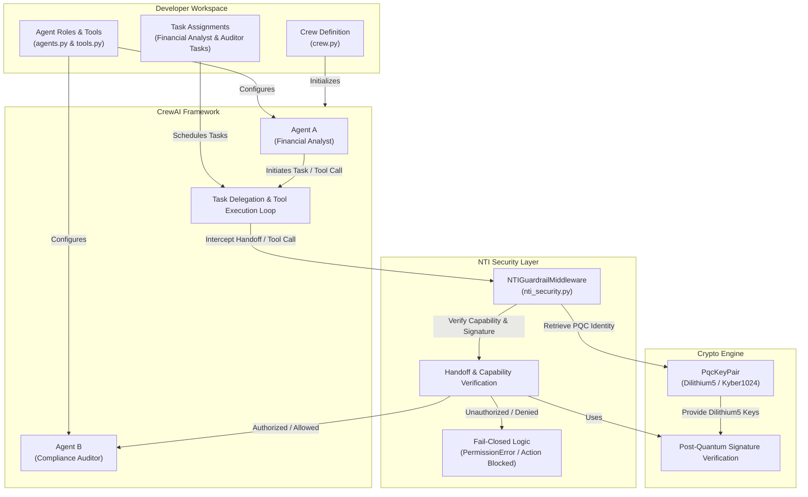

# NTI Secure CrewAI Template

[](https://opensource.org/licenses/MIT)

A working CrewAI multi-agent crew with NTI (Neutral Trust Infrastructure) post-quantum security pre-installed.

Every tool call from every agent is cryptographically verified before execution using all 5 pillars of NTI:
1. Zero-Trust Capability Enforcement
2. NIST Post-Quantum Cryptography (Dilithium5 / Kyber1024)
3. BFT Multi-Agent Consensus
4. Merkle-Chained Audit Trails
5. P2P Agent Mesh & State Persistence

## Quick Start

```bash
git clone https://github.com/abisheakp197/nti-crewai-template.git my-crew
cd my-crew
pip install -r requirements.txt
cp .env.example .env
# Add your OPENAI_API_KEY to .env
python crew.py
```

## What Just Happened

- The analyst agent executed `execute_transfer` and `read_account` because NTI granted those capabilities.
- The auditor agent reviewed the action using `read_account`.
- If any agent tried to call `delete_account`, NTI would raise `PermissionError` before the tool ran.

## How To Grant Capabilities

In `tools.py` or your NTI security layer, use the `NTIGuardrailMiddleware` via `nti_security`:

```python
from nti_security import get_nti_middleware, wrap_tool_with_nti

nti_middleware = get_nti_middleware(
    agent_id="analyst_agent",
    granted_capabilities=["execute_transfer", "read_account"],
)

# Wrap tool with NTI capability enforcement
execute_transfer = wrap_tool_with_nti(execute_transfer, nti_middleware)
```

Any tool call without an explicit capability grant is automatically blocked with an `NTI Security Denied Action` `PermissionError`.

## Project Structure

- `crew.py` — Crew definition + environment validation
- `agents.py` — Agent definitions with NTI-secured tools
- `tools.py` — Available tools wrapped with NTI security
- `nti_security.py` — NTI middleware and capability wrapping configuration
- `requirements.txt` — Dependencies (crewai, ube-foundation, crewai-nti)
- `SECURITY.md` — Security policy and vulnerability disclosure guidelines
- `LICENSE` — License terms

## License

MIT License. See [LICENSE](LICENSE).

## Links

- Core SDK: https://pypi.org/project/ube-foundation/
- CrewAI wrapper: https://pypi.org/project/crewai-nti/
- Homepage: https://abisheakp197.github.io/Neutral-Trust-Infrastructure/

## Architecture


